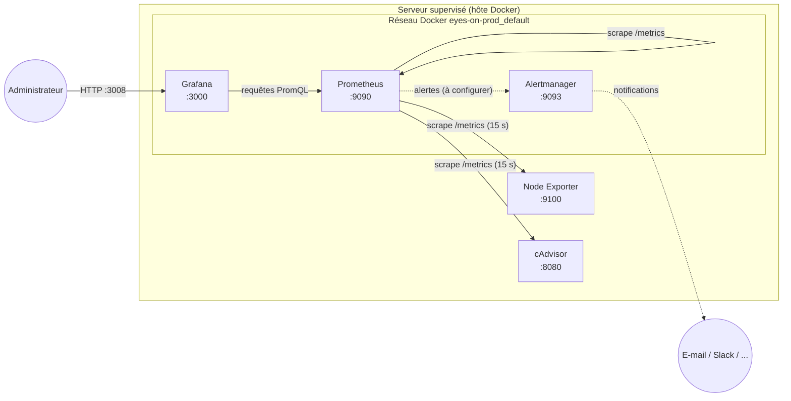
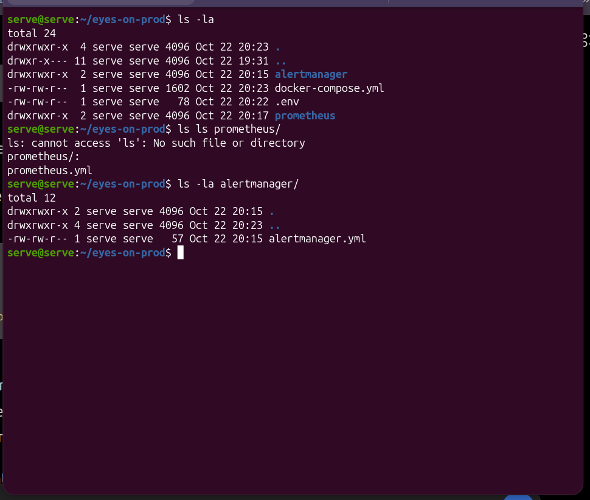
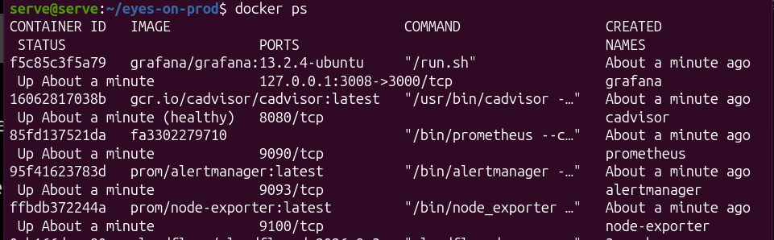

# 01 — Architecture

## Vue d'ensemble



## Composants

| Service | Responsabilité | Source des données |
|---|---|---|
| **Node Exporter** | Expose les métriques du système hôte | `/proc`, `/sys` et le système de fichiers racine monté en lecture seule sur `/host` |
| **cAdvisor** | Expose la consommation CPU/RAM/réseau/IO par conteneur | `/sys`, `/var/run`, `/var/lib/docker` (lecture seule) |
| **Prometheus** | Interroge les exporteurs toutes les 15 s, stocke les séries temporelles, évalue les règles d'alerte | Cibles déclarées dans `prometheus/prometheus.yml` |
| **Grafana** | Affiche les métriques sous forme de tableaux de bord | Source de données Prometheus |
| **Alertmanager** | Déduplique, groupe et route les alertes vers des canaux de notification | Alertes envoyées par Prometheus |

## Modèle de collecte

Prometheus fonctionne en **pull** : il appelle périodiquement l'endpoint HTTP `/metrics` de chaque cible. Conséquences :

- un exporteur n'a pas besoin de connaître Prometheus ;
- une cible injoignable est immédiatement visible (`up == 0`) ;
- Prometheus doit pouvoir joindre chaque cible sur le réseau (d'où le VPN pour les serveurs distants, cf. [04](04-vpn-wireguard.md)).

## Réseau

Tous les services partagent le réseau bridge créé par Compose (`<projet>_default`). Le DNS interne de Docker résout chaque **nom de service** (`prometheus`, `node-exporter`, `cadvisor`, ...) vers l'IP du conteneur correspondant.

| Service | Port publié sur l'hôte | Accès |
|---|---|---|
| Grafana | `3008 → 3000` | Seul point d'entrée exposé |
| Prometheus | aucun | Interne uniquement (`http://prometheus:9090`) |
| Alertmanager | aucun | Interne uniquement |
| Node Exporter | aucun | Interne uniquement |
| cAdvisor | aucun | Interne uniquement |

> `127.0.0.1` dans un conteneur désigne le conteneur lui-même, pas l'hôte ni les autres services. Toujours utiliser le nom de service.

## Persistance

| Volume nommé | Monté dans | Contenu |
|---|---|---|
| `prom_data` | `prometheus:/prometheus` | Base TSDB (rétention : `--storage.tsdb.retention.time=30d`) |
| `grafana_data` | `grafana:/var/lib/grafana` | Base SQLite Grafana (utilisateurs, dashboards, sources de données) |

Les fichiers de configuration sont montés en lecture seule (`:ro`) depuis le dossier du projet.

## Arborescence sur le serveur

```
~/eyes-on-prod/
├── docker-compose.yml
├── .env                       # chmod 600
├── prometheus/
│   └── prometheus.yml
└── alertmanager/
    └── alertmanager.yml
```



## État attendu après déploiement

```bash
docker compose ps
```

Les cinq conteneurs doivent être `Up` (cAdvisor affiche en plus `healthy`).


