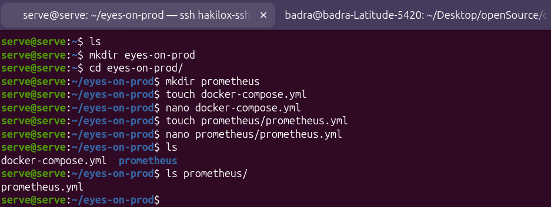

# 02 — Prometheus

Prometheus collecte à intervalle régulier les métriques exposées par les exporteurs et les stocke dans une base de séries temporelles (TSDB). Il évalue aussi les règles d'alerte et les transmet à Alertmanager.

Exemples de métriques collectées :

| Domaine | Métrique | Exporteur |
|---|---|---|
| CPU | `node_cpu_seconds_total` | Node Exporter |
| Mémoire | `node_memory_MemAvailable_bytes` | Node Exporter |
| Disque | `node_filesystem_avail_bytes` | Node Exporter |
| Réseau | `node_network_receive_bytes_total` | Node Exporter |
| Conteneurs | `container_cpu_usage_seconds_total`, `container_memory_usage_bytes` | cAdvisor |
| Disponibilité | `up` | Prometheus (généré pour chaque cible) |

## 1. Préparer l'arborescence

```bash
mkdir -p ~/eyes-on-prod/prometheus
cd ~/eyes-on-prod
touch docker-compose.yml prometheus/prometheus.yml
```



## 2. Service dans `docker-compose.yml`

Fichier complet : [docker/docker-compose.yml](../docker/docker-compose.yml)

```yaml
services:
  prometheus:
    image: prom/prometheus@sha256:fa3302279710be2f21a8301ec17a8b4f2301fd829bd113839b3b6b02b6f191a2
    container_name: prometheus
    restart: unless-stopped
    volumes:
      - ./prometheus/prometheus.yml:/etc/prometheus/prometheus.yml:ro
      - prom_data:/prometheus
    command:
      - --config.file=/etc/prometheus/prometheus.yml
      - --storage.tsdb.retention.time=30d

  node-exporter:
    image: prom/node-exporter:latest
    container_name: node-exporter
    restart: unless-stopped
    pid: host
    volumes:
      - /:/host:ro,rslave
    command:
      - --path.rootfs=/host

  cadvisor:
    image: gcr.io/cadvisor/cadvisor:latest
    container_name: cadvisor
    restart: unless-stopped
    volumes:
      - /:/rootfs:ro
      - /var/run:/var/run:ro
      - /sys:/sys:ro
      - /var/lib/docker:/var/lib/docker:ro

volumes:
  prom_data:
```

| Paramètre | Explication |
|---|---|
| `image: ...@sha256:` | Image épinglée par digest : déploiement reproductible |
| `restart: unless-stopped` | Redémarre automatiquement sauf arrêt manuel |
| `prometheus.yml:ro` | Configuration montée en lecture seule |
| `prom_data:/prometheus` | Volume nommé : les données survivent à la recréation du conteneur |
| `--storage.tsdb.retention.time=30d` | Purge automatique des données de plus de 30 jours |
| `pid: host` (node-exporter) | Accès aux processus de l'hôte |
| `/:/host:ro,rslave` + `--path.rootfs=/host` | Node Exporter lit le système de fichiers de l'hôte, pas celui du conteneur |

Aucun port n'est publié : Prometheus n'est joignable que depuis le réseau Docker.

## 3. Configuration `prometheus.yml`

Fichier : [docker/prometheus/prometheus.yml](../docker/prometheus/prometheus.yml)

```yaml
global:
  scrape_interval: 15s
  evaluation_interval: 15s
  external_labels:
    monitor: 'eyes-on-prod'

scrape_configs:
  - job_name: 'prometheus'
    static_configs:
      - targets: ['localhost:9090']

  - job_name: 'node-exporter'
    static_configs:
      - targets: ['node-exporter:9100']
        labels:
          host: 'eyes-on-export'

  - job_name: 'cadvisor'
    static_configs:
      - targets: ['cadvisor:8080']
```

### Section `global`

| Clé | Valeur | Rôle |
|---|---|---|
| `scrape_interval` | `15s` | Fréquence d'interrogation des cibles. Compromis entre finesse (détection des pics) et volume stocké. |
| `evaluation_interval` | `15s` | Fréquence d'évaluation des règles d'alerte. À garder égale au `scrape_interval`. |
| `external_labels` | `monitor: eyes-on-prod` | Labels ajoutés à toute donnée sortant de Prometheus (alertes, fédération). Identifie l'instance émettrice. |

### Section `scrape_configs`

| Clé | Rôle |
|---|---|
| `job_name` | Regroupe des cibles de même nature. Devient le label `job` de chaque série (filtrage dans Grafana : `{job="node-exporter"}`). |
| `static_configs` | Cibles déclarées manuellement (par opposition à la découverte automatique). |
| `targets` | Liste `hôte:port`. Dans Docker, utiliser le **nom de service**. |
| `labels` | Labels personnalisés, ex. `host` pour identifier la machine lorsque plusieurs serveurs seront supervisés. |

### Pièges courants

| Erreur | Symptôme | Correction |
|---|---|---|
| Indentation YAML incorrecte (`static_configs` pas au niveau de `job_name`) | Prometheus refuse de démarrer | Respecter l'indentation (2 espaces, pas de tabulation) |
| `static_configs:` manquant avant `- targets:` | Erreur de parsing | Ajouter la clé |
| Clé mal orthographiée (`labes`) | `field labes not found` | Corriger la clé |
| Cible `127.0.0.1:9100` | Cible `DOWN`, `connection refused` | Dans un conteneur, `127.0.0.1` = le conteneur lui-même. Utiliser `node-exporter:9100` |

## 4. Valider et appliquer

```bash
# Valider la syntaxe avant de (re)démarrer
docker compose run --rm --entrypoint promtool prometheus \
  check config /etc/prometheus/prometheus.yml

# Démarrer / appliquer les changements du compose
docker compose up -d

# Recharger uniquement la configuration (sans perte de données)
docker compose kill -s SIGHUP prometheus
```

## 5. Vérification

```bash
# Santé du service
docker compose exec prometheus wget -qO- http://localhost:9090/-/healthy
# → Prometheus Server is Healthy.

# État des cibles (toutes doivent être "up")
docker compose exec prometheus wget -qO- http://localhost:9090/api/v1/targets \
  | grep -o '"health":"[a-z]*"'

# Logs en cas d'erreur
docker compose logs -f prometheus
```

Accès à l'interface web sans publier le port, via un tunnel SSH :

```bash
# Récupérer l'IP du conteneur sur le serveur
docker inspect -f '{{range .NetworkSettings.Networks}}{{.IPAddress}}{{end}}' prometheus

# Depuis le poste local
ssh -L 9090:<ip-conteneur>:9090 user@serveur
# puis ouvrir http://localhost:9090/targets
```

## Référence

- [Configuration Prometheus](https://prometheus.io/docs/prometheus/latest/configuration/configuration/)
- [Node Exporter](https://github.com/prometheus/node_exporter)
- [cAdvisor](https://github.com/google/cadvisor)
