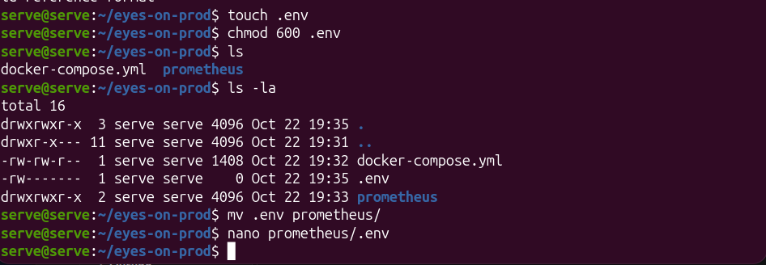
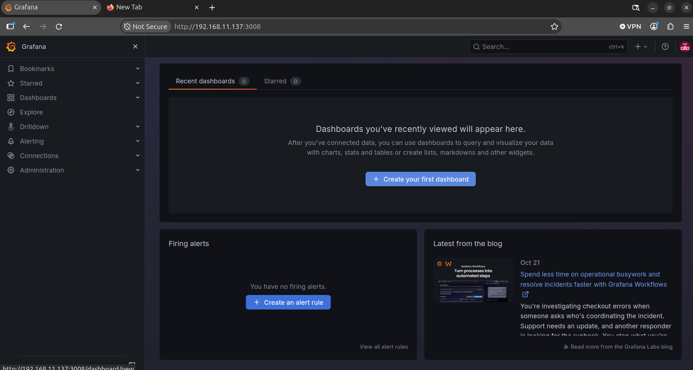
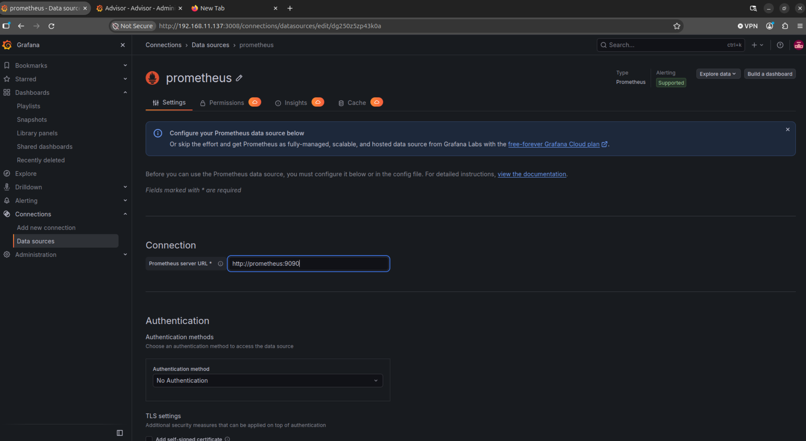
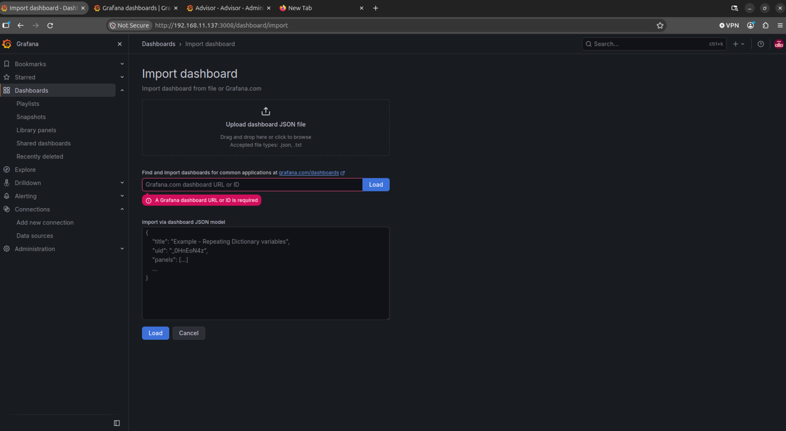
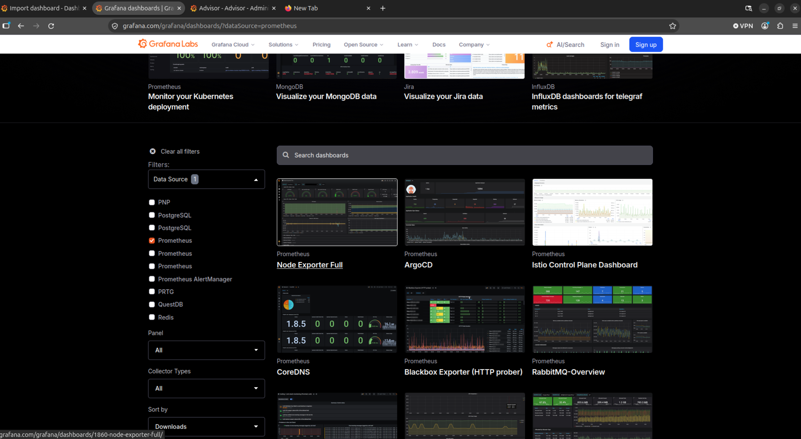
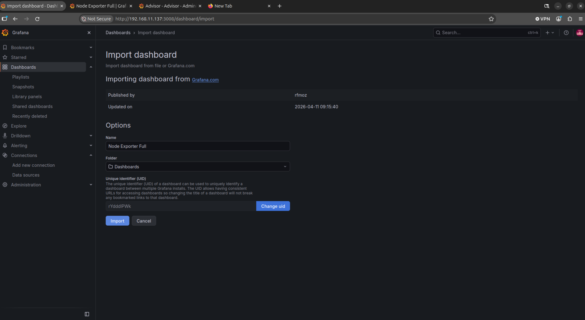
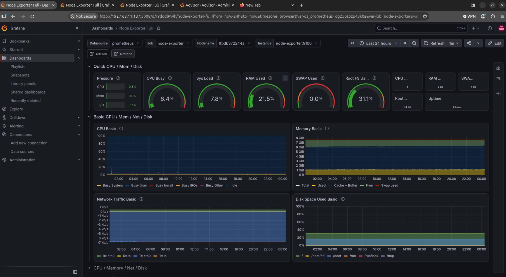

# 03 — Grafana

Grafana interroge Prometheus en PromQL et restitue les métriques sous forme de tableaux de bord interactifs. Dans cette architecture, il ne collecte aucune donnée lui-même.

Cas d'usage :
- utilisation CPU, RAM et disque de l'hôte dans le temps ;
- consommation par conteneur Docker ;
- détection visuelle des anomalies et des tendances ;
- visualisation de l'état des alertes.

## 1. Gestion des identifiants (`.env`)

Les identifiants administrateur ne sont pas écrits en clair dans le `docker-compose.yml` : ils sont lus depuis un fichier `.env` placé **à la racine du projet** (même dossier que `docker-compose.yml`), que Compose charge automatiquement pour substituer les variables `${...}`.

```bash
cd ~/eyes-on-prod
cat > .env <<'EOF'
GRAFANA_ADMIN_USER=admin
GRAFANA_ADMIN_PASSWORD=<mot-de-passe-fort>
EOF
chmod 600 .env       # lecture/écriture pour le propriétaire uniquement
ls -la .env          # attendu : -rw-------
```



> Le fichier `.env` ne doit jamais être versionné. Ajouter `.env` au `.gitignore` et fournir un `.env.example` sans valeurs.

## 2. Service dans `docker-compose.yml`

```yaml
  grafana:
    image: grafana/grafana:13.2.4-ubuntu@sha256:d838696907b4350d9232eb8da1503dc1d1010a0359d3ce4b3f7d2ff7db28eb75
    container_name: grafana
    restart: unless-stopped
    ports:
      - "3008:3000"
    environment:
      GF_SECURITY_ADMIN_USER: ${GRAFANA_ADMIN_USER}
      GF_SECURITY_ADMIN_PASSWORD: ${GRAFANA_ADMIN_PASSWORD}
      GF_USERS_ALLOW_SIGN_UP: "false"
    volumes:
      - grafana_data:/var/lib/grafana
    depends_on:
      - prometheus

volumes:
  grafana_data:
```

| Paramètre | Explication |
|---|---|
| `ports: "3008:3000"` | Grafana écoute sur 3000 dans le conteneur, publié sur le port 3008 de l'hôte. Pour restreindre à la machine locale (accès via VPN/tunnel) : `"127.0.0.1:3008:3000"` |
| `GF_SECURITY_ADMIN_*` | Compte administrateur créé au **premier** démarrage uniquement. Changer la valeur ensuite n'a pas d'effet (voir *Dépannage*). |
| `GF_USERS_ALLOW_SIGN_UP: "false"` | Désactive l'inscription libre |
| `grafana_data` | Persiste la base interne (utilisateurs, dashboards, sources de données) |
| `depends_on: prometheus` | Ordre de démarrage (ne garantit pas que Prometheus soit prêt) |

> Le compose actuel contient aussi `env_file: .env`, qui injecte **toutes** les variables du fichier dans le conteneur. Il est redondant avec le bloc `environment` et peut être supprimé.

## 3. Démarrage et vérification

```bash
docker compose up -d grafana
docker compose logs -f grafana          # attendre "HTTP Server Listen"
curl -s http://localhost:3008/api/health
# → {"database":"ok", "version":"13.2.4", ...}
```

Se connecter sur `http://<ip-serveur>:3008` avec les identifiants du `.env`.



## 4. Ajouter Prometheus comme source de données

### Option A — Interface web

1. **Connections → Data sources → Add data source → Prometheus**
2. **Prometheus server URL** : `http://prometheus:9090` (nom du service Docker, pas `localhost`)
3. **Save & test** → `Successfully queried the Prometheus API.`



### Option B — Provisioning (recommandé)

Déclarer la source de données dans un fichier versionné, appliqué automatiquement à chaque démarrage.

Fichier : [docker/grafana/provisioning/datasources/prometheus.yml](../docker/grafana/provisioning/datasources/prometheus.yml)

```yaml
apiVersion: 1

datasources:
  - name: Prometheus
    type: prometheus
    access: proxy
    url: http://prometheus:9090
    isDefault: true
    editable: false
```

Montage à ajouter au service `grafana` :

```yaml
    volumes:
      - grafana_data:/var/lib/grafana
      - ./grafana/provisioning:/etc/grafana/provisioning:ro
```

> Le fichier de provisioning est présent dans le dépôt, mais ce montage n'est pas encore ajouté au `docker-compose.yml`. Si une source `prometheus` a déjà été créée via l'interface, supprimer l'une des deux pour éviter les doublons.

## 5. Tableaux de bord

### Import d'un dashboard communautaire

1. **Dashboards → New → Import**.

   

2. Trouver l'ID sur [grafana.com/grafana/dashboards](https://grafana.com/grafana/dashboards/) en filtrant par source de données `Prometheus`. L'ID figure dans l'URL (`/dashboards/1860-node-exporter-full/` → `1860`).

   

3. Saisir l'ID, **Load**, choisir le dossier et la source `Prometheus`, puis **Import**.

   

| ID | Dashboard | Exporteur |
|---|---|---|
| `1860` | Node Exporter Full | Node Exporter |
| `9628` | PostgreSQL Database | postgres_exporter (cf. [08](08-database.md)) |

Pour cAdvisor, rechercher « cAdvisor » dans le catalogue.

Résultat : dashboard Node Exporter Full, filtrable par `Job`, `Nodename` et `Instance`.



### Requêtes PromQL de base

| Panneau | Requête |
|---|---|
| CPU utilisé (%) | `100 - avg by (instance) (rate(node_cpu_seconds_total{mode="idle"}[5m])) * 100` |
| RAM utilisée (%) | `(1 - node_memory_MemAvailable_bytes / node_memory_MemTotal_bytes) * 100` |
| Disque utilisé (%) `/` | `(1 - node_filesystem_avail_bytes{mountpoint="/"} / node_filesystem_size_bytes{mountpoint="/"}) * 100` |
| CPU par conteneur | `sum by (name) (rate(container_cpu_usage_seconds_total{name!=""}[5m]))` |
| RAM par conteneur | `sum by (name) (container_memory_usage_bytes{name!=""})` |
| Cibles hors ligne | `up == 0` |

## Dépannage

| Symptôme | Cause probable | Solution |
|---|---|---|
| `Save & test` échoue | URL `localhost:9090` | Utiliser `http://prometheus:9090` |
| Identifiants du `.env` refusés | Le compte admin a été créé lors d'un démarrage précédent | `docker compose exec grafana grafana cli admin reset-admin-password <nouveau>` |
| Variables vides au démarrage | `.env` absent du dossier du `docker-compose.yml` | Placer `.env` à la racine du projet ; vérifier avec `docker compose config` |
| Dashboard vide (« No data ») | Cible `DOWN` ou mauvaise source de données | Vérifier `up` dans Explore et les cibles Prometheus |

## Référence

- [Installer Grafana avec Docker](https://grafana.com/docs/grafana/latest/setup-grafana/installation/docker/)
- [Configurer Grafana avec des variables d'environnement](https://grafana.com/docs/grafana/latest/setup-grafana/configure-grafana/)
- [Provisioning](https://grafana.com/docs/grafana/latest/administration/provisioning/)
