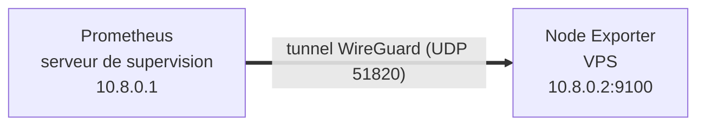

# 04 — VPN WireGuard

> Statut : **à réaliser**

## Objectif

Superviser des serveurs distants (ex. un VPS) sans exposer leurs exporteurs sur Internet. Prometheus interroge les exporteurs distants à travers un tunnel WireGuard chiffré.



## Plan

| Étape | Description |
|---|---|
| 1 | Installer WireGuard sur le serveur de supervision et sur chaque serveur distant |
| 2 | Générer une paire de clés par pair (`wg genkey \| tee privatekey \| wg pubkey > publickey`) |
| 3 | Définir le plan d'adressage du tunnel (ex. `10.8.0.0/24`) |
| 4 | Configurer `/etc/wireguard/wg0.conf` sur chaque pair et activer `wg-quick@wg0` |
| 5 | Sur le serveur distant : faire écouter Node Exporter uniquement sur l'IP du tunnel (`--web.listen-address=10.8.0.2:9100`) |
| 6 | Pare-feu : n'autoriser le port 9100 que depuis l'interface `wg0` |
| 7 | Ajouter la cible dans `prometheus.yml` avec un label `host` |

Exemple de cible à ajouter :

```yaml
  - job_name: 'node-exporter'
    static_configs:
      - targets: ['node-exporter:9100']
        labels:
          host: 'eyes-on-export'
      - targets: ['10.8.0.2:9100']
        labels:
          host: 'vps-01'
```

## Vérification

```bash
sudo wg show                      # handshake récent avec chaque pair
curl -s http://10.8.0.2:9100/metrics | head
```

## Référence

- [WireGuard — Quick Start](https://www.wireguard.com/quickstart/)
