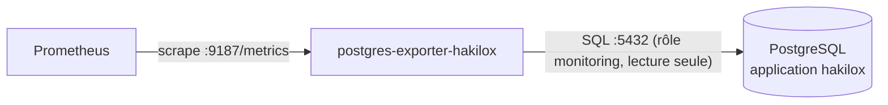
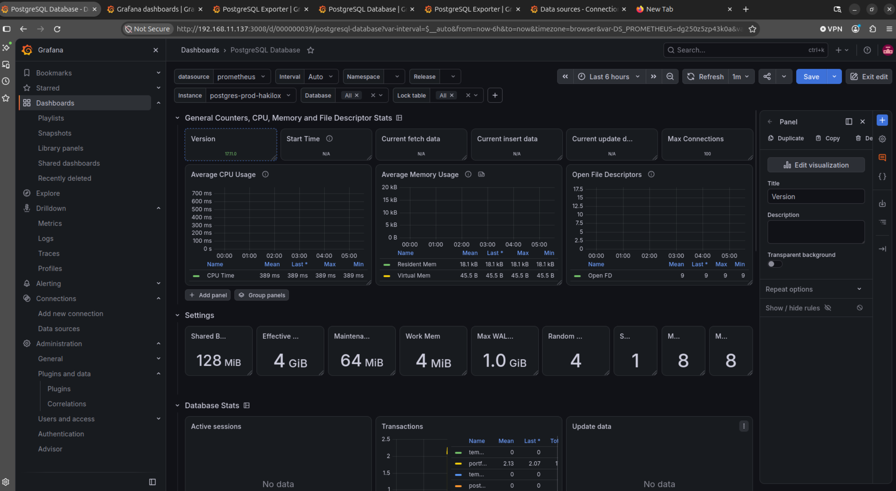

# 08 — Surveillance de PostgreSQL

## Objectif

Aller au-delà de « le conteneur PostgreSQL tourne » (déjà couvert par cAdvisor) et mesurer la **santé de la base** :

| Question | Métriques |
|---|---|
| La base répond-elle ? | `pg_up` |
| Les connexions sont-elles proches de la limite ? | `pg_stat_database_numbackends`, `pg_settings_max_connections` |
| Les transactions échouent-elles ? | `pg_stat_database_xact_commit`, `pg_stat_database_xact_rollback` |
| Y a-t-il des blocages ? | `pg_locks_count`, `pg_stat_database_deadlocks` |
| Le cache est-il efficace ? | `pg_stat_database_blks_hit`, `pg_stat_database_blks_read` |
| La base grossit-elle anormalement ? | `pg_database_size_bytes` |

## Architecture

PostgreSQL n'expose pas de métriques Prometheus nativement. **postgres_exporter** se connecte à la base comme un client SQL, lit les vues statistiques (`pg_stat_*`, `pg_locks`, `pg_settings`) et les publie sur `:9187/metrics`.



Contrainte réseau : l'exporteur doit joindre **à la fois** PostgreSQL et Prometheus. Si la base tourne dans un autre projet Compose (cas de l'application hakilox), il faut rattacher l'exporteur au réseau Docker de cette application (voir étape 3).

## 1. Créer un rôle de supervision dédié

Ne jamais utiliser le superutilisateur `postgres`. Le rôle prédéfini `pg_monitor` (PostgreSQL ≥ 10) donne accès en **lecture** à toutes les vues statistiques, sans accès aux données métier.

```bash
docker exec -it <conteneur-postgres> psql -U postgres
```

```sql
CREATE USER monitoring WITH PASSWORD '<secret-fort>';
GRANT CONNECT ON DATABASE postgres TO monitoring;
GRANT pg_monitor TO monitoring;
```

Générer le secret :

```bash
openssl rand -base64 32
```

Vérifier :

```bash
docker exec -it <conteneur-postgres> \
  psql -U monitoring -d postgres -c "SELECT count(*) FROM pg_stat_activity;"
```

## 2. Stocker le secret dans `.env`

Ajouter au fichier `.env` du projet (déjà en `chmod 600`) :

```env
POSTGRES_MONITORING_PASSWORD=<secret-fort>
```

## 3. Ajouter l'exporteur dans `docker-compose.yml`

```yaml
services:
  postgres-exporter-hakilox:
    image: quay.io/prometheuscommunity/postgres-exporter:latest   # à épingler (tag ou digest)
    container_name: postgres-exporter-hakilox
    restart: unless-stopped
    environment:
      DATA_SOURCE_URI: "<conteneur-postgres>:5432/postgres?sslmode=disable"
      DATA_SOURCE_USER: "monitoring"
      DATA_SOURCE_PASS: "${POSTGRES_MONITORING_PASSWORD}"
    expose:
      - "9187"
    networks:
      - default          # réseau de la stack de supervision (joignable par Prometheus)
      - hakilox_net      # réseau de l'application (joint PostgreSQL)

networks:
  hakilox_net:
    external: true
    name: <nom-du-reseau-de-l-application>   # voir : docker network ls
```

| Paramètre | Explication |
|---|---|
| `DATA_SOURCE_URI` | Hôte, port, base et options **sans** identifiants. `<conteneur-postgres>` = nom du conteneur ou du service PostgreSQL sur le réseau partagé. |
| `DATA_SOURCE_USER` / `DATA_SOURCE_PASS` | Identifiants séparés de l'URI : le mot de passe vient du `.env` et n'apparaît pas dans le compose. |
| `sslmode=disable` | Acceptable car le trafic reste dans le réseau Docker de l'hôte. Passer à `require` si la base est distante. |
| `expose: 9187` | Port documenté pour les autres conteneurs, non publié sur l'hôte. |
| `networks` | Double rattachement : réseau de supervision + réseau de l'application. |
| `external: true` | Le réseau existe déjà (créé par le Compose de l'application) ; Compose ne le crée pas. |

Trouver le nom du conteneur et du réseau PostgreSQL :

```bash
docker ps --filter "ancestor=postgres" --format '{{.Names}}'
docker inspect -f '{{range $k, $v := .NetworkSettings.Networks}}{{$k}} {{end}}' <conteneur-postgres>
```

### Alternative : `DATA_SOURCE_NAME`

L'exporteur accepte aussi une chaîne de connexion unique :

```env
DATA_SOURCE_NAME=postgresql://monitoring:<secret>@<conteneur-postgres>:5432/postgres?sslmode=disable
```

Le mot de passe est alors inclus dans l'URL : il doit être encodé (caractères `@`, `:`, `/`) et apparaît dans `docker inspect`. La méthode URI + USER + PASS ci-dessus est préférée.

## 4. Déclarer la cible dans Prometheus

Ajouter dans `prometheus/prometheus.yml`, sous `scrape_configs` :

```yaml
  - job_name: 'postgres'
    static_configs:
      - targets: ['postgres-exporter-hakilox:9187']
        labels:
          instance: 'postgres-prod-hakilox'
```

> La cible doit utiliser le **nom du service** de l'exporteur (`postgres-exporter-hakilox`), pas un nom générique. Le label `instance` remplace `postgres-exporter-hakilox:9187` par un nom lisible dans Grafana.

Appliquer :

```bash
docker compose up -d postgres-exporter-hakilox
docker compose kill -s SIGHUP prometheus
```

## 5. Vérification

```bash
# Logs de l'exporteur : aucune erreur d'authentification
docker compose logs postgres-exporter-hakilox

# Depuis Prometheus : la base est joignable (pg_up 1)
docker compose exec prometheus \
  wget -qO- http://postgres-exporter-hakilox:9187/metrics | grep '^pg_up'
```

| Résultat | Signification |
|---|---|
| `pg_up 1` | Exporteur connecté à la base |
| `pg_up 0` | Exporteur démarré mais connexion SQL refusée → vérifier mot de passe, `DATA_SOURCE_URI`, réseau |
| `bad address` / timeout | Prometheus ne joint pas l'exporteur → vérifier le nom de service et le réseau `default` |

La cible `postgres` doit apparaître `UP` dans `/api/v1/targets` (cf. [02 — Prometheus](02-prometheus.md#5-vérification)).

## 6. Visualisation dans Grafana

Importer le dashboard communautaire **PostgreSQL Database** (ID `9628`) via **Dashboards → New → Import**, en sélectionnant la source `Prometheus`. Choisir ensuite l'instance `postgres-prod-hakilox` dans le sélecteur `Instance`.



Requêtes PromQL utiles :

| Panneau | Requête |
|---|---|
| Base joignable | `pg_up` |
| Connexions utilisées (%) | `sum by (instance) (pg_stat_database_numbackends) / on (instance) pg_settings_max_connections * 100` |
| Transactions / s | `sum by (instance) (rate(pg_stat_database_xact_commit[5m]) + rate(pg_stat_database_xact_rollback[5m]))` |
| Taux de rollback (%) | `sum(rate(pg_stat_database_xact_rollback[5m])) / sum(rate(pg_stat_database_xact_commit[5m]) + rate(pg_stat_database_xact_rollback[5m])) * 100` |
| Cache hit ratio (%) | `sum(rate(pg_stat_database_blks_hit[5m])) / sum(rate(pg_stat_database_blks_hit[5m]) + rate(pg_stat_database_blks_read[5m])) * 100` |
| Deadlocks | `increase(pg_stat_database_deadlocks[1h])` |
| Taille par base | `pg_database_size_bytes` |

## 7. Alertes proposées

À ajouter dans `prometheus/rules/postgres.yml` (cf. [05 — Alertes](05-alertes.md)) :

| Alerte | Expression | Durée | Sévérité |
|---|---|---|---|
| `PostgresDown` | `pg_up == 0` | 1m | critical |
| `PostgresTooManyConnections` | `sum by (instance) (pg_stat_database_numbackends) / on (instance) pg_settings_max_connections > 0.8` | 5m | warning |
| `PostgresDeadlocks` | `increase(pg_stat_database_deadlocks[10m]) > 0` | 0m | warning |
| `PostgresLowCacheHitRatio` | ratio cache hit `< 0.9` | 15m | warning |

## Note : projets Compose sur des réseaux différents

Chaque projet Compose crée son propre réseau. Si PostgreSQL appartient au projet de l'application et l'exporteur au projet de supervision, ils ne se voient pas : `pg_up` reste à `0` et les logs de l'exporteur affichent une erreur de résolution DNS ou de connexion.

```bash
docker network ls                                   # lister les réseaux
docker inspect -f '{{range $k, $v := .NetworkSettings.Networks}}{{$k}} {{end}}' <conteneur-postgres>
```

**Méthode rapide (temporaire)** : connecter le conteneur de l'exporteur au réseau de l'application.

```bash
# docker network connect <réseau> <conteneur>
docker network connect <reseau-application> postgres-exporter-hakilox
```

> Cette connexion est perdue dès que Compose recrée le conteneur (`docker compose up -d` après une modification, mise à jour d'image). Le second argument est un **conteneur**, pas un réseau.

**Méthode persistante (recommandée)** : déclarer le réseau externe dans `docker-compose.yml`, comme décrit à l'[étape 3](#3-ajouter-lexporteur-dans-docker-composeyml).

## Référence

- [postgres_exporter](https://github.com/prometheus-community/postgres_exporter)
- [Rôles prédéfinis PostgreSQL (`pg_monitor`)](https://www.postgresql.org/docs/current/predefined-roles.html)
- [Vues statistiques PostgreSQL](https://www.postgresql.org/docs/current/monitoring-stats.html)
