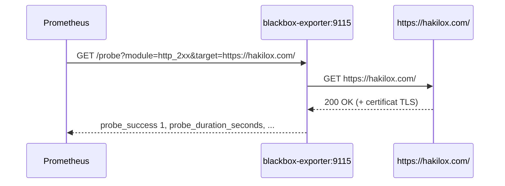

# 09 — Blackbox Exporter

## Objectif

Vérifier la disponibilité des sites **du point de vue d'un utilisateur**. Les autres exporteurs lisent des métriques internes (CPU, connexions SQL...) ; Blackbox Exporter, lui, **sonde de l'extérieur** : il envoie une vraie requête HTTPS et mesure le résultat.

| Question | Métrique |
|---|---|
| Le site répond-il correctement (2xx) ? | `probe_success` |
| Quel code HTTP est renvoyé ? | `probe_http_status_code` |
| Combien de temps prend la réponse ? | `probe_duration_seconds`, `probe_http_duration_seconds` (par phase : DNS, connexion, TLS, traitement, transfert) |
| Quand expire le certificat TLS ? | `probe_ssl_earliest_cert_expiry` |

Sites sondés :

| Site | Job |
|---|---|
| `https://hakilox.com/` | `blackbox-https` |
| `https://djigitech.site/` | `blackbox-https` |

## Fonctionnement

Blackbox Exporter ne connaît pas les sites à sonder. C'est **Prometheus** qui lui passe l'URL en paramètre à chaque scrape :



Conséquence : la sonde part **du serveur de supervision**. Elle valide la résolution DNS, le TLS et la réponse HTTP depuis ce serveur, pas depuis le poste d'un visiteur.

## 1. Arborescence

```
~/eyes-on-prod/
├── blackbox/
│   └── blackbox.yml              # modules de sonde
└── prometheus/
    ├── prometheus.yml            # job blackbox-https + rule_files
    └── rules/
        └── blackbox.yml          # règles d'alerte
```

```bash
mkdir -p ~/eyes-on-prod/blackbox ~/eyes-on-prod/prometheus/rules
```

## 2. Configuration de l'exporteur — `blackbox/blackbox.yml`

Fichier : [docker/blackbox/blackbox.yml](../docker/blackbox/blackbox.yml)

```yaml
modules:
  http_2xx:
    prober: http
    timeout: 10s
    http:
      method: GET
      follow_redirects: true
      preferred_ip_protocol: ip4
```

| Clé | Rôle |
|---|---|
| `http_2xx` | Nom du module, référencé par Prometheus dans `params.module` |
| `prober: http` | Type de sonde (`http`, `tcp`, `icmp`, `dns`, `grpc`) |
| `timeout: 10s` | Durée max de la sonde. Doit rester **inférieure** au `scrape_interval` (15 s) |
| `method: GET` | Requête envoyée |
| `follow_redirects: true` | Suit les redirections (ex. `http → https`, `/ → /fr/`) ; le succès est évalué sur la réponse finale |
| `preferred_ip_protocol: ip4` | Force l'IPv4 (par défaut `ip6`, qui échoue si le serveur n'a pas de connectivité IPv6) |

Par défaut, `http_2xx` considère comme succès tout code 2xx. Options utiles si besoin :

```yaml
      valid_status_codes: [200]       # n'accepter que 200
      fail_if_not_ssl: true           # échec si la réponse finale n'est pas en HTTPS
```

## 3. Service Docker — `docker-compose.yml`

```yaml
  blackbox-exporter:
    image: prom/blackbox-exporter:latest   # à épingler (tag ou digest)
    container_name: blackbox-exporter
    restart: unless-stopped
    volumes:
      - ./blackbox/blackbox.yml:/config/blackbox.yml:ro
    command:
      - "--config.file=/config/blackbox.yml"
    expose:
      - "9115"
```

| Paramètre | Explication |
|---|---|
| `volumes` | Configuration montée en lecture seule |
| `--config.file` | Chemin de la configuration **dans** le conteneur |
| `expose: 9115` | Joignable par Prometheus sur le réseau Docker, non publié sur l'hôte |

L'exporteur a besoin d'un accès **sortant** à Internet (HTTPS 443, DNS 53), fourni par défaut par le réseau bridge de Docker.

## 4. Job Prometheus — `prometheus/prometheus.yml`

Fichier : [docker/prometheus/prometheus.yml](../docker/prometheus/prometheus.yml)

```yaml
scrape_configs:
  - job_name: 'blackbox-https'
    metrics_path: /probe
    params:
      module: [http_2xx]
    static_configs:
      - targets:
          - 'https://hakilox.com/'
          - 'https://djigitech.site/'
    relabel_configs:
      - source_labels: [__address__]
        target_label: __param_target
      - source_labels: [__param_target]
        target_label: instance
      - target_label: __address__
        replacement: blackbox-exporter:9115
```

| Clé | Rôle |
|---|---|
| `metrics_path: /probe` | Endpoint de sonde de l'exporteur (et non `/metrics`) |
| `params.module` | Module de `blackbox.yml` à utiliser → `?module=http_2xx` |
| `targets` | Les **URL à sonder**, pas l'adresse de l'exporteur |

Le bloc `relabel_configs` réécrit chaque cible avant le scrape :

| Règle | Avant | Après | Effet |
|---|---|---|---|
| 1 | `__address__ = https://hakilox.com/` | `__param_target = https://hakilox.com/` | L'URL devient le paramètre `?target=` |
| 2 | `__param_target` | `instance = https://hakilox.com/` | Label `instance` lisible dans Grafana et les alertes |
| 3 | — | `__address__ = blackbox-exporter:9115` | La requête est envoyée à l'exporteur |

Ajouter un site = ajouter une ligne sous `targets`, puis recharger Prometheus.

## 5. Alertes — `prometheus/rules/blackbox.yml`

Fichier : [docker/prometheus/rules/blackbox.yml](../docker/prometheus/rules/blackbox.yml)

```yaml
groups:
  - name: blackbox-alerts
    rules:
      - alert: WebsiteDown
        expr: probe_success{job="blackbox-https"} == 0
        for: 2m
        labels:
          severity: critical
        annotations:
          summary: "Site indisponible : {{ $labels.instance }}"
          description: "Le test HTTPS échoue depuis plus de 2 minutes pour {{ $labels.instance }}."

      - alert: SslCertificateExpiringSoon
        expr: (probe_ssl_earliest_cert_expiry{job="blackbox-https"} - time()) / 86400 < 14
        for: 1h
        labels:
          severity: warning
        annotations:
          summary: "Certificat TLS bientôt expiré : {{ $labels.instance }}"
          description: "Le certificat de {{ $labels.instance }} expire dans {{ $value | humanize }} jours."
```

| Alerte | Déclenchement | Sévérité |
|---|---|---|
| `WebsiteDown` | Sonde en échec pendant 2 min consécutives (≈ 8 scrapes) | critical |
| `SslCertificateExpiringSoon` | Certificat valide moins de 14 jours, pendant 1 h | warning |

Le `job="blackbox-https"` de l'expression doit correspondre **exactement** au `job_name` du scrape.

### Chargement des règles

Dans `prometheus/prometheus.yml`, **au niveau racine** (pas dans `scrape_configs`) :

```yaml
alerting:
  alertmanagers:
    - static_configs:
        - targets: ['alertmanager:9093']

rule_files:
  - /etc/prometheus/rules/*.yml
```

Et dans le service `prometheus` du `docker-compose.yml`, monter le dossier des règles en conservant les montages existants :

```yaml
    volumes:
      - ./prometheus/prometheus.yml:/etc/prometheus/prometheus.yml:ro
      - ./prometheus/rules:/etc/prometheus/rules:ro
      - prom_data:/prometheus
```

> Alertmanager reçoit désormais les alertes, mais son récepteur `default` n'envoie encore aucune notification (cf. [05 — Alertes](05-alertes.md)). Les alertes restent visibles dans Prometheus (`/alerts`) et Grafana.

## 6. Déploiement

```bash
cd ~/eyes-on-prod

# Valider les fichiers avant d'appliquer
docker compose config --quiet
docker compose run --rm --entrypoint promtool prometheus \
  check config /etc/prometheus/prometheus.yml
docker compose run --rm --entrypoint blackbox_exporter blackbox-exporter \
  --config.file=/config/blackbox.yml --config.check

# Appliquer (recrée prometheus pour le nouveau montage, démarre blackbox)
docker compose up -d
```

Résultat attendu de `promtool` : `SUCCESS: 1 rule files found` puis `SUCCESS: 2 rules found`.

## 7. Vérification

```bash
# Sonde manuelle via l'exporteur
docker compose exec prometheus wget -qO- \
  'http://blackbox-exporter:9115/probe?module=http_2xx&target=https://hakilox.com/' \
  | grep -E '^probe_(success|http_status_code|duration_seconds)'
```

| Résultat | Signification |
|---|---|
| `probe_success 1` | Site joignable, code 2xx |
| `probe_success 0` + `probe_http_status_code 5xx` | Le serveur répond mais en erreur (application, reverse proxy) |
| `probe_success 0` + `probe_http_status_code 0` | Pas de réponse HTTP : DNS, TLS, timeout ou IPv6. Ajouter `&debug=true` à l'URL pour le détail |

```bash
# Règles chargées et état des alertes
docker compose exec prometheus wget -qO- http://localhost:9090/api/v1/rules | grep -o '"name":"[A-Za-z]*"'
docker compose exec prometheus wget -qO- http://localhost:9090/api/v1/alerts
```

## 8. Visualisation dans Grafana

Importer un dashboard communautaire : rechercher « Blackbox Exporter » sur [grafana.com/grafana/dashboards](https://grafana.com/grafana/dashboards/) (filtre Prometheus), puis **Dashboards → New → Import** (cf. [03 — Grafana](03-grafana.md#5-tableaux-de-bord)).

Requêtes PromQL utiles :

| Panneau | Requête |
|---|---|
| Disponibilité instantanée | `probe_success{job="blackbox-https"}` |
| Disponibilité sur 24 h (%) | `avg_over_time(probe_success{job="blackbox-https"}[24h]) * 100` |
| Temps de réponse (s) | `probe_duration_seconds{job="blackbox-https"}` |
| Code HTTP | `probe_http_status_code{job="blackbox-https"}` |
| Jours avant expiration TLS | `(probe_ssl_earliest_cert_expiry{job="blackbox-https"} - time()) / 86400` |

## Pièges courants

| Erreur | Symptôme | Correction |
|---|---|---|
| `metrics_path` laissé à `/metrics` ou préfixé (`/blackbox-exporter/probe`) | 404, cible `DOWN` | `metrics_path: /probe` |
| `replacement` ne correspond pas au nom du service (`prometheus-blackbox-exporter:9115`) | `no such host` | Utiliser le nom du service Compose : `blackbox-exporter:9115` |
| `job` de la règle différent du `job_name` (`blackbox-http` vs `blackbox-https`) | L'alerte ne se déclenche jamais | Aligner les deux noms |
| `rule_files` ajouté sous `scrape_configs` | Prometheus refuse de démarrer | Le placer au niveau racine |
| Dossier `rules` non monté | `promtool` : `0 rule files found` ; aucune règle dans `/alerts` | Ajouter le montage `./prometheus/rules` |
| `timeout` ≥ `scrape_interval` | Scrapes en échec intermittent | Garder `timeout` < 15 s |

## Référence

- [blackbox_exporter](https://github.com/prometheus/blackbox_exporter)
- [Configuration des modules](https://github.com/prometheus/blackbox_exporter/blob/master/CONFIGURATION.md)
- [Alerting rules](https://prometheus.io/docs/prometheus/latest/configuration/alerting_rules/)
